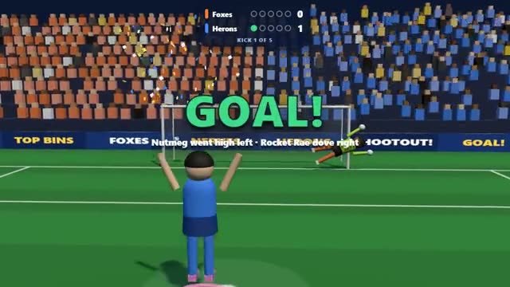

# Penalty Kicks

Pick your corner. Hope the keeper guesses wrong. A multiplayer starter game from [Multiplayer Agent](https://multiplayeragent.com): 3D, party, 2–8 players, with bots that fill the teams.

## How it plays

Two teams take turns from the spot. The kicker aims and times a power bar while the keeper picks a dive, both in secret, then the kick shows who guessed right. Five each, then sudden death; everyone takes a turn kicking and in goal.

**Controls:** Kicker: mouse or arrows to aim, hold and release Space or click for power · Keeper: ← ↓ → · touch: drag to aim, hold KICK; DIVE buttons.

## Make it yours in the Game Builder

Open the [Game Builder](https://multiplayeragent.com), choose **Start from a starter game** and pick Penalty Kicks. It opens as version 1 in your studio, ready to play and publish. Then ask for changes, for example:

- Add a golden goal ball worth two in the last round
- Let the keeper dive high or low too, not just left and right
- Make it a snowy night match with the crowd waving flags

## Run it yourself

1. Get a free publishable key (`pk_…`) at [multiplayeragent.com](https://multiplayeragent.com).
2. In `index.html`, put it in place of `pk_REPLACE_ME` in the `MP_CONNECT` block.
3. Serve the folder (for example `npx serve`) and open it. The 3D engine loads as a module, which browsers block from a file on disk.

Without a key it still runs, offline against bots.

## How it is built

- One `index.html`, plus three.js in `libs/`. The comment at the top of the script maps the code and explains the multiplayer.
- **Hidden info:** Your aim or dive goes only to the host's browser, which shows both picks together when the kick happens. Nothing about a pick is in the shared state until then.
- **Host-run rounds:** The host's browser runs the turns, the timer and the score; if it leaves, the next player takes over and everyone re-sends their pick.
- **Bots:** Bots fill the teams and each kicks and dives with its own favorite side.
- **Leaderboard:** Total goals scored, for every player.
- `?attract` runs it offline, bots only. The preview video is recorded from it.

## License

MIT.
